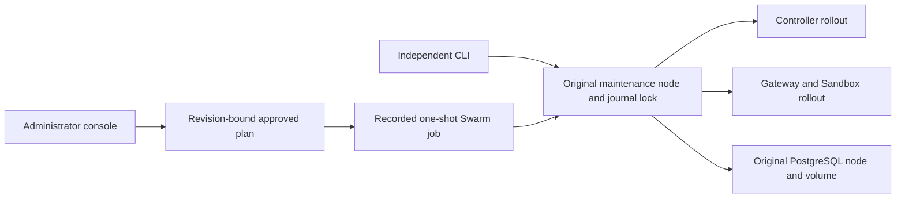

# Bootstrap and system maintenance

The installation executor runs independently of Controller tasks. Each installation
has one durable identity, one maintenance host and one private journal directory.
Copying checkpoints to another host does not authorize taking over a writer.
The product version remains unchanged.

## Supported installation contract

Linux Docker Engine must already be installed. Both amd64 and arm64 are supported;
images must match the node platform. A new single-node installation has one
Manager, Controller, production Gateway, PostgreSQL and dedicated Sandbox. New
multi-node installations select three Managers. PostgreSQL and Sandbox remain
pinned to one data node and volume. Controller/Gateway redundancy is **not full
HA**: database, host, zone and external ingress failures need separate recovery.

SSH identities must already be trusted in `known_hosts`. Use private key files or
an existing SSH agent, with root or noninteractive sudo. The installer never turns
off host verification, changes Docker daemon permissions, leaves a foreign Swarm,
or replaces a Worker entry with a Manager. Docker socket groups must match across
Controller nodes and permit non-root access. Bootstrap uses the standard
`/var/run/docker.sock` on each SSH host; login Docker contexts and remote
`DOCKER_HOST` overrides cannot select another Engine. Image preparation uses
only the explicit registry reference, or an empty private auth configuration.

## CLI workflow

Run the executor on its selected maintenance node. Protect the configuration and
state directory and its offline sibling from other users. The state directory is
reserved for typed installation metadata, plans and guided input; keep SSH keys,
private Controller configurations, credentials, runtime files and diagnostics
outside it. Symlink aliases do not bypass this boundary. A missing existing
writer-lock file blocks mutation until previous writers are fenced and the
original maintenance boundary is restored. Guided installation is available with:

```sh
nsc-controller bootstrap init --interactive --state-dir /var/lib/nsc-bootstrap
```

For unattended setup, create a private configuration such as:

```yaml
mode: single
name: nsc
maintenance_node: node-1
data_node: node-1
node_dir: /var/lib/nsc
console_port: 8443
known_hosts_file: /etc/nsc-bootstrap/known_hosts
nodes:
  - name: node-1
    address: 192.0.2.10
    ssh_user: operator
    ssh_port: 22
    ssh_key_file: /etc/nsc-bootstrap/ssh-key
    manager: true
images:
  controller: registry.example.test/nsc/controller@sha256:REPLACE_WITH_VERIFIED_DIGEST
  gateway: registry.example.test/nsc/gateway@sha256:REPLACE_WITH_VERIFIED_DIGEST
  postgresql: registry.example.test/postgres@sha256:REPLACE_WITH_VERIFIED_DIGEST
# Optional private references; values never belong in this configuration.
# admin_password_file: /etc/nsc-bootstrap/administrator-password
# registry_auth_file: /etc/nsc-bootstrap/registry-config.json
```

Example addresses and placeholder digests are not deployable defaults. Supply
verified Controller/Gateway bootstrap-contract 1, protocol 2, schema 18 images
(the Controller also requires maintenance contract 1),
and PostgreSQL 18 Alpine. Registry authentication uses a private Docker `auths`
configuration, transmitted through SSH stdin into a temporary private directory.
Credential helpers are not executed by the installer.

```sh
nsc-controller bootstrap init --config /etc/nsc-bootstrap/install.yaml \
  --state-dir /var/lib/nsc-bootstrap
nsc-controller bootstrap init --config /etc/nsc-bootstrap/install.yaml \
  --state-dir /var/lib/nsc-bootstrap --plan /var/lib/nsc-bootstrap/plan.json \
  --approve PLAN_SHA256 --idempotency-key UNIQUE_REQUEST_KEY
nsc-controller bootstrap status --state-dir /var/lib/nsc-bootstrap
nsc-controller bootstrap verify --config /etc/nsc-bootstrap/install.yaml \
  --state-dir /var/lib/nsc-bootstrap
nsc-controller bootstrap resume --config /etc/nsc-bootstrap/install.yaml \
  --state-dir /var/lib/nsc-bootstrap --operation RECORDED_OPERATION_ID
```

Review the exact plan: nodes, immutable images, cluster, database pin, downtime
and retention implications. Approval expires after ten minutes and binds the
installation revision, configuration and current observed resource versions. A
changed or expired plan must be regenerated. Reusing a request key with another
plan fails. There is no generic confirmation bypass.

## Installation and access

The installer pulls and checks image compatibility before creating identities.
It prepares or verifies Swarm, reserves the real NSC Service IDs without starting
tasks, distributes independent runtime identities, starts PostgreSQL, migrates
once offline and seeds stable administrator, Pool, Runtime and certificate IDs.
All running Controllers have `auto_migrate=false`.

The existing authenticated reconciler creates the protected Gateway project,
`prod` and `sandbox` environments and four system applications. The Sandbox has
an isolated network and no published ports. Installation requires a fresh
Controller/Manager observation, a real Sandbox NGINX validation, positive loaded
Gateway revisions with matching digests, administrator login and actual access.
Task RUNNING, version zero and a lone heartbeat do not establish completion.

The independent Controller HTTPS listener defaults to port 8443 and does not
need a domain or working Gateway. Its certificate contains inventory IP SANs
and defaults to twenty calendar years. The handoff prints console URLs,
certificate SHA-256 and private recovery/administrator file locations, never the
password. Verify the fingerprint through a trusted channel. DNS Domains still
require DNS names; IP SANs are certificate assets rather than Domain records.

An operator who has rotated the administrator password can pass a private current
credential using `--credential-file`. This transient input does not rewrite the
original recovery material or reset the administrator. Retain original material
only as protected historical recovery evidence; it is not proof of a valid login.

## Failure and recovery boundaries

Operations use PENDING, RUNNING, SUCCEEDED, BLOCKED, FAILED and UNKNOWN. Intent is
saved before a change and actual receipts before advancing. A lost response is
UNKNOWN even if Docker may have completed the write. Resume first performs
read-only reconciliation. A matching name or label cannot replace a creation
receipt. Completed material creation has a durable digest; partial or modified
private identities remain blocked rather than being regenerated.

Node-local configuration, Engine and Swarm identities and service versions are
checked before continuation. External changes require review. Failed installation
retains its database, volume, identities, operation history and private diagnostics.
There is no implicit uninstall or empty-volume replacement on another node.

After an acknowledged rollout is interrupted, continuation waits within its
existing deadline for the original authenticated Controller binding to return.
New mutations still require immediate proof. Changed identity or storage evidence
and an expired deadline cannot become a successful continuation.

A private PostgreSQL custom-format archive is checked with `pg_restore --list`
before Controller handoff. Keep the archive, matching encryption/session keys,
installation record and identity material together, offline and protected. This
is an initial database recovery point, not scheduled backup or application-volume
backup. A later system maintenance operation needs its own current backup.
Restoring database/business data is separate from image or configuration rollback.
The local archive limit is 1 GiB; a larger database requires a separately verified
backup procedure before maintenance.

Runtime mTLS identities are independent and the offline CA key is never copied
into running services. Runtime leaves have their own expiry, independent of the
twenty-year console certificate. Keep offline identity material available for
controlled renewal; losing a private key does not authorize minting a replacement
identity during repair.

## Verification and delivery status

The first three stages have independent local commits and recorded source-bound
single-node, three-node, failure/recovery and adoption acceptance. System
maintenance uses the additional acceptance described below. Delivery requires
backend coverage, frontend checks, the complete harness and applicable isolated
integration evidence for the same source; pending or failed evidence is never
reported as a completed stage. OVH DNS verification remains DISABLED.

The disposable acceptance fixture never uses the host Swarm. It verifies actual
PostgreSQL, SSH, Docker, NSC and NGINX in owned nested nodes. Nested nodes share a
physical host, so their results do not establish host or zone resilience. See
[Docker's Manager guidance](https://docs.docker.com/engine/swarm/admin_guide/)
and [Secrets documentation](https://docs.docker.com/engine/swarm/secrets/).

## Existing Swarm adoption

`bootstrap adopt` uses an explicit `adoption` section in the private installation
configuration. Supply the existing Controller configuration file, Cluster ID,
four actual Service IDs (`controller`, `postgresql`, `nginx`, `nginx-sandbox`),
original PostgreSQL Node ID and volume. Planning reads the actual registration,
Manager membership, Engine bindings, storage and mounted public identities; it
does not provision or rename services. Explicit credential references are read
through the authenticated original service mounts or its verified Swarm Secret
task, without importing the executor shell's `NSC_*` environment.

An existing installation marker additionally requires its exact installation ID
and original maintenance directory. Copying a journal to another directory on
the same machine cannot authorize another writer. Keep the original maintenance
node and journal; adoption is not a takeover of an active or unisolated executor.
Legacy deployments without an installation marker receive a new stable
installation ID while retaining all existing Service, Runtime, Pool, certificate,
administrator and application IDs.

Adoption preserves existing voting membership, including two-Manager clusters;
new multi-node installation still requires three Managers. Plans and status expose
the actual majority and tolerable failures, including Managers outside the NSC
inventory. A drained or unavailable data/maintenance node blocks ownership
registration. An offline non-data node may retain its previously registered
identity with explicit unverified drift; an SSH host-key or authentication error
cannot use that fallback.

Registration completion is independent of health. Adoption records `UNVERIFIED`
until actual access, fresh authenticated reports and loaded configuration have
been checked. Expired original identities remain explicit drift and are never
silently replaced. Legacy installations lacking independent HTTPS or new system
interfaces require CLI preparation before Web maintenance. No schema migration,
password reset, database relocation or service update occurs during adoption.

Swarm may advance a Service's object version for runtime status without changing
its Spec. Read-only verification accepts that monotonic status change while
still rejecting Spec drift. Every subsequent update retains an exact current
object-version precondition; verification does not grant a stale update approval.

Completed bootstrap Sandbox validation remains historical acceptance evidence.
Later draft edits or validation expiry do not invalidate an installed cluster.
Independent verification checks current ownership, node identities, fresh loaded
Gateway evidence and actual access. An unfinished installation's resume still
requires its original source-bound validation to be current before handoff.

## Preparing an adopted installation for Web maintenance

Adoption itself changes registration only. On the original maintenance node,
use the original offline CA certificate/private key and a compatible release
manifest to prepare the first independent executor. Run initial preparation as
the original metadata-directory owner. A password rotated since installation
requires a private current administrator `--credential-file` for final login.

```sh
nsc-controller bootstrap upgrade --prepare-web \
  --config /etc/nsc-bootstrap/adopt.yaml --state-dir /var/lib/nsc-bootstrap \
  --ca-cert-file /etc/nsc-bootstrap/offline-ca.crt \
  --ca-key-file /etc/nsc-bootstrap/offline-ca.key \
  --release /etc/nsc-bootstrap/release.json
nsc-controller bootstrap upgrade --prepare-web \
  --config /etc/nsc-bootstrap/adopt.yaml --state-dir /var/lib/nsc-bootstrap \
  --ca-cert-file /etc/nsc-bootstrap/offline-ca.crt \
  --ca-key-file /etc/nsc-bootstrap/offline-ca.key \
  --plan /var/lib/nsc-bootstrap/plan.json --approve PLAN_SHA256 \
  --idempotency-key UNIQUE_PREPARATION_KEY
```

The approved plan binds the original cluster, Engine/node identities, service
specifications, storage, current private configuration and original CA. The
operator's private Controller configuration copy must match its actual mounted
configuration. Preparation retains a current verified PostgreSQL archive and
matching original configuration/identity files, then writes new node-local
configuration files without replacing the original files. It preserves existing
administrators, session/encryption keys, component identities, Service IDs, data
volumes, topology and Gateway domain/certificate bindings. The separate console
receives an IP SAN certificate valid for twenty years and its own certificate
asset. The CA key stays offline; it is absent from runtime node files and the
maintenance Secret.

Supported legacy layouts use PostgreSQL 18 (`nsc` database/user), an authenticated
Controller on the fixed data node, four explicitly registered system component
services, numeric non-root Controller ownership and the existing internal 9444
listener. A Controller service must be global, or single-replica on a single
Controller node. Unknown storage/configuration layouts, environment overrides,
ambiguous networks, missing original CA keys, changed ownership or incompatible
schemas block preparation. These cases require explicit protected CLI review;
the installer does not reset credentials or silently convert business data.
Previously prepared installations with lost identities must restore their
matching recovery material instead of using first-time preparation to replace it.

After the Controller's Swarm update is completed, fresh Controller/Manager reports,
loaded Gateway configuration, actual HTTP/HTTPS access and the existing
administrator login are verified, the target
becomes the first verified release baseline and Web maintenance opens. An old
unverified image gains no automatic rollback rights. Use `bootstrap resume` with
the same local operation after interruption; Web cannot take over an independent
CLI writer. Resume uses the original recorded CA references and rejects new CA
flag overrides. Partial identity creation and creations without returned IDs remain
UNKNOWN until their original evidence is restored or reviewed.

## Controlled system maintenance

Open `/infrastructure/installation` as an administrator. The page reports the
actual installation, quorum, console certificate, component IDs, database pin,
drift and durable operation progress. `system=true` continues to prohibit normal
application stop, edit and deletion. `management_mode=system` additionally needs
a valid installation and exact registered object IDs. Legacy system observations
remain `observed` until adoption; `managed` keeps its original application meaning.
The reserved executor belongs to the protected Controller application and is idle
between approved operations. It is not a fifth product application.



Web requests use these administrator-only endpoints:

- `GET /api/v1/system/installation`
- `POST /api/v1/system/installation/plans`
- `POST /api/v1/system/installation/operations`
- `GET /api/v1/system/installation/operations/{id}`

A submission includes the exact plan hash, installation revision and an
`Idempotency-Key`. Plans expire after ten minutes and are checked again against
actual ownership before execution. The review lists observed target nodes, known
component IDs, data pin and downtime before approval. A release manifest is accepted
only for an upgrade; repair and verification cannot replace the release baseline.
Reconnect using `?job=<recorded-job-id>`; the
page reads current persisted progress rather than retaining an old success.
An UNKNOWN operation resumes only with the same approved plan and recorded job;
only the current Swarm job iteration can prove a stopped runner. Old, missing or
orphaned tasks never authorize a replacement. A delayed poll or acknowledgement
cannot overwrite newer progress or a terminal receipt.
A new writer is refused until the previous task is confirmed stopped. A pending
job on an unavailable maintenance node does not authorize moving the journal or
starting a writer elsewhere. No endpoint accepts Shell, Compose or Docker input.

The task uses the last verified Controller image and is pinned to the original
maintenance node. Controller replacement cannot terminate this independent
process. The task mounts journal metadata, the local Docker socket, machine
identity and one recorded Secret. It never mounts SSH keys, the offline CA key,
administrator password, session key or application encryption keys. Its separate
mTLS identity can read typed installation health and physical binding evidence;
it cannot forward mutations or publish Controller node observations. The Secret
contains a database connection and maintenance leaf, so protect Manager access.
Web maintenance requires fresh authenticated data-node identity evidence; custom
worker-only data nodes without that reporting remain CLI-only.

New installations keep metadata in the selected state directory and recovery
materials in the sibling `<state-directory>.offline` directory. Existing mixed
layouts remain CLI-only. Adoption alone does not provision a new maintenance
identity or rewrite old node files. A missing/expired Secret or old HTTP-only
console requires explicit CLI preparation; ordinary repair never invents keys.
The initial console certificate defaults to twenty years. The maintenance leaf
and node mTLS leaves have their own shorter validity and need planned renewal.

### Release manifest and CLI operation

Use a privately retained manifest for a verified release. Replace every digest
with the actual immutable published reference; these placeholders cannot execute:

```json
{
  "version": "v0.1.0",
  "images": {
    "controller": "registry.example.test/nsc-controller@sha256:REPLACE_WITH_VERIFIED_DIGEST",
    "gateway": "registry.example.test/nsc-gateway@sha256:REPLACE_WITH_VERIFIED_DIGEST",
    "postgresql": "registry.example.test/postgres@sha256:REPLACE_WITH_ORIGINAL_DIGEST"
  },
  "protocol": 2,
  "schema": 18,
  "configuration": 1,
  "postgresql_major": 18,
  "architectures": ["amd64", "arm64"]
}
```

Image contracts are inspected before service updates. Controller targets must
also implement `io.nsc.bootstrap.maintenance=1`. Unknown protocol, schema,
configuration and PostgreSQL-major transitions are blocked; this release has no
automatic database migration path for maintenance. The original PostgreSQL image,
volume, node, credentials and business data remain pinned. Scoped registry pull authentication is retained only in the protected
maintenance Secret and Docker request headers, and is selected only for the
approved registry authority. The CLI uses its explicit private
`registry_auth_file`; credential helpers are never executed. Service updates
reuse their recorded authentication when no explicit scoped auth is supplied. Cross-
registry credentials require separate CLI preparation rather than forwarding
old credentials to a new authority. Web image preparation rejects unconfirmed
or different node platforms; a mixed-platform inventory requires per-node CLI
image preparation. A local image inspection does not prove every architecture
of a multi-platform release.

```sh
nsc-controller bootstrap upgrade --config /etc/nsc-bootstrap/install.yaml \
  --state-dir /var/lib/nsc-bootstrap --release /etc/nsc-bootstrap/release.json
nsc-controller bootstrap upgrade --config /etc/nsc-bootstrap/install.yaml \
  --state-dir /var/lib/nsc-bootstrap --plan /var/lib/nsc-bootstrap/plan.json \
  --approve PLAN_SHA256 --idempotency-key OPERATOR_SELECTED_UNIQUE_KEY
```

The same plan/approval workflow applies to `repair` and `rollback`. Repair accepts
an explicit component selection, for example `--components controller,nginx`.
PostgreSQL restart must be explicitly selected; repair never changes its image or
placement. A compatible rollout updates Controller, Gateway and Sandbox in order,
checking actual task images, fresh loaded evidence and real HTTPS/HTTP access at
each boundary. Single-node maintenance can interrupt the console and ingress.
A bad image pauses instead of becoming a successful release. The independent CLI
can approve rollback while the console is unavailable.

Rollback requires a complete recorded release, unchanged configuration and
non-image service specifications, matching object IDs and unchanged PostgreSQL
image. It consumes the previous compatible history entry. It never restores a
database, application volume or old credential. Interrupted writes retain UNKNOWN
until their exact known Service ID and intended specification can be reconciled.
An external specification change blocks repair and rollback rather than being
overwritten. Prepared recovery databases retain their separate recovery barrier.
System maintenance outcomes appear in activity and the existing deployment
notification group; repeated polling does not create duplicate notifications.

## Reproducing system maintenance acceptance

Use source-bound Controller/Gateway images, the pinned SSH fixture image and an
installed isolated Playwright Chromium (or `CHROME_BIN`). The fixture builds its
own different Controller binary and negative image, pushes only to its disposable
authenticated registry with runtime-generated credentials and removes only
invocation-owned objects:

```sh
python3 scripts/bootstrap_acceptance.py \
  --controller-image nsc-controller:local --gateway-image nsc-gateway:local \
  --fixture-image nsc-bootstrap-ssh-fixture:local \
  --nodes 3 --cli-user 1000 --browser --maintenance --recovery \
  --output coverage/bootstrap/current/summary.json
```

Acceptance covers interrupted executor continuation, duplicate submissions,
actual rolling image replacement, session retention, console reconnection,
responsive progress, bad-image pause, offline CLI rollback and data/identity
preservation, authenticated private-image preparation, and legacy HTTP adoption
through independent HTTPS and real Web maintenance. Node-failure acceptance
waits for the actual Swarm failed-node decision and consecutive HTTP responses,
recording convergence time separately from Manager health. It is included in the existing source-bound P0 job. A local command
or committed workflow does not establish a remote PASS: consult the recorded
source fingerprint, image digests and individual outcomes. OVH stays DISABLED.
